# HomeVault

A self-hosted web app for managing home ownership documents, equipment, and
maintenance — property vaults, expiring-document/warranty reminders, a
month/list maintenance calendar, home-office expense tracking, QR-labeled
equipment with a maintenance history, and shared access for the whole
household. Built to run in a single Docker container on a
NAS or homelab, with all data kept local. Installable as a PWA on iOS and
Android.

**[Releases](https://github.com/Installation-04/HomeVault/releases)** — tagged
versions with notes on what changed.

## Quick start

You need a Linux machine (a server, a NAS, or a **Raspberry Pi 3/4/5 with a 64-bit OS**) with
Docker. HomeVault runs on Intel/AMD (amd64) and ARM (arm64).

```bash
curl -fsSL https://raw.githubusercontent.com/Installation-04/HomeVault/main/install.sh | bash
```

The installer downloads the newest release and starts a short **setup wizard**: how you will reach
HomeVault (home network, your own domain with automatic HTTPS, or behind a reverse proxy), where to
keep the data, language, optional email reminders, one-click updates, nightly backups and your
administrator account. A few minutes later it is running and tells you the address.

Prefer to read the script first?

```bash
git clone https://github.com/Installation-04/HomeVault.git && cd HomeVault
./deploy.sh install        # asks the same questions; add --yes to skip them
```

Then turn on two-factor authentication under *Settings → Security*.

**Keeping it up to date:** when a new version is released, administrators see a notice and an
**Update** button in *Settings → Administration*. It makes a backup, installs the new version and
rolls back by itself if that version doesn't start. From a terminal: `./deploy.sh update`.

Day-to-day: `./deploy.sh status`, `logs`, `backup`, `restore <file>`, `doctor`. Everything is in
[docs/DEPLOYMENT.md](docs/DEPLOYMENT.md); how the app protects your data is in
[docs/SECURITY.md](docs/SECURITY.md); what changed is in the [changelog](CHANGELOG.md).

### Raspberry Pi and other ARM boards

Use a **64-bit** operating system (Raspberry Pi OS 64-bit on a Pi 3, 4 or 5; a 32-bit system is
refused with an explanation). The wizard picks the ready-made image, which is a quick download;
building from source on a Pi works but takes a long time. HomeVault is light: with under 1.5 GB of
RAM the wizard limits it to 512 MB, which is plenty for a household. Keep the data on a USB SSD
rather than the SD card if you can.

## Screenshots

| Dashboard | Documents |
| --- | --- |
| 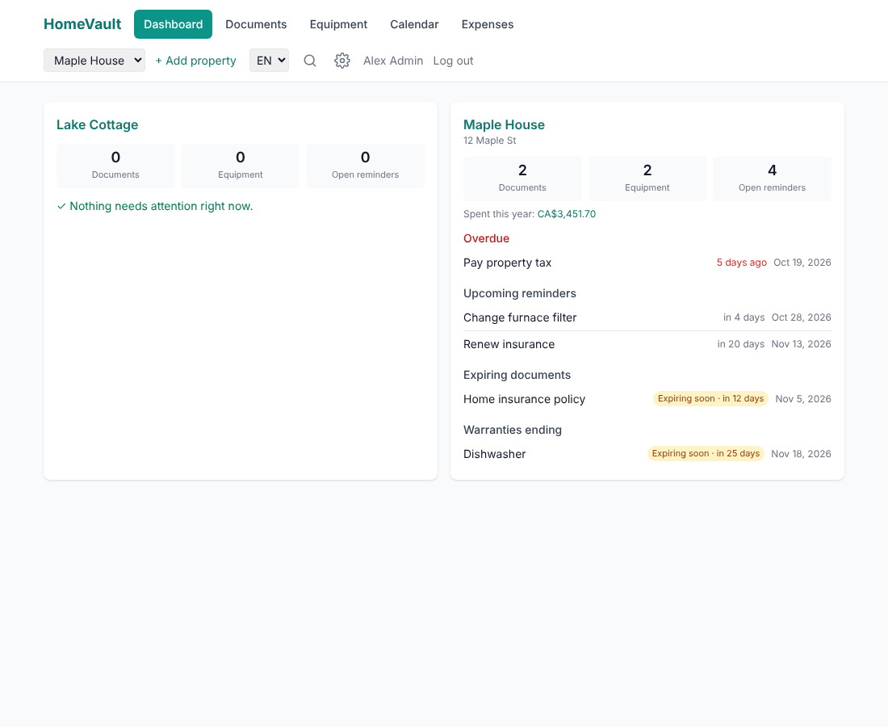 | 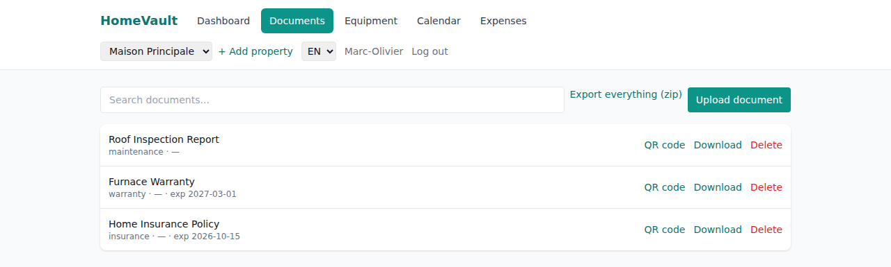 |

| Equipment | Equipment detail |
| --- | --- |
| 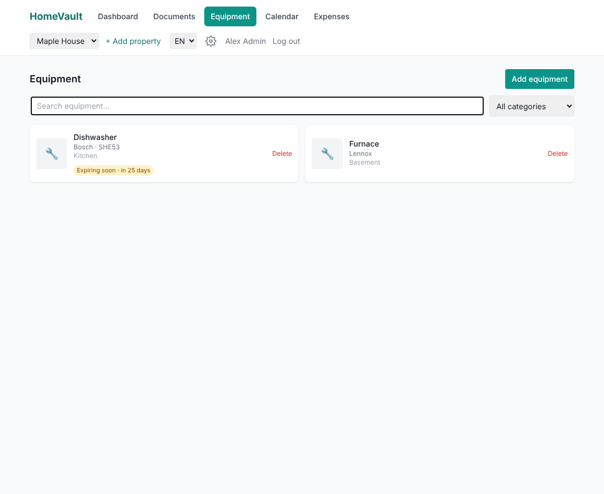 | 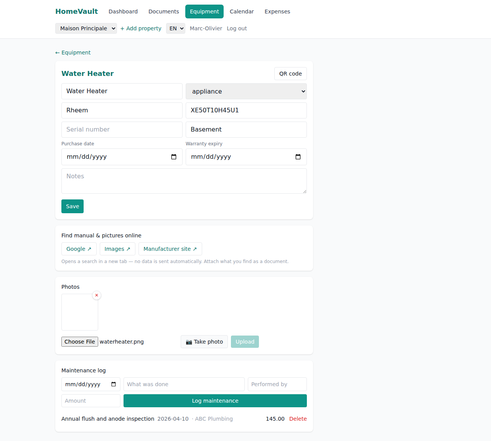 |

| Calendar | Expenses |
| --- | --- |
| 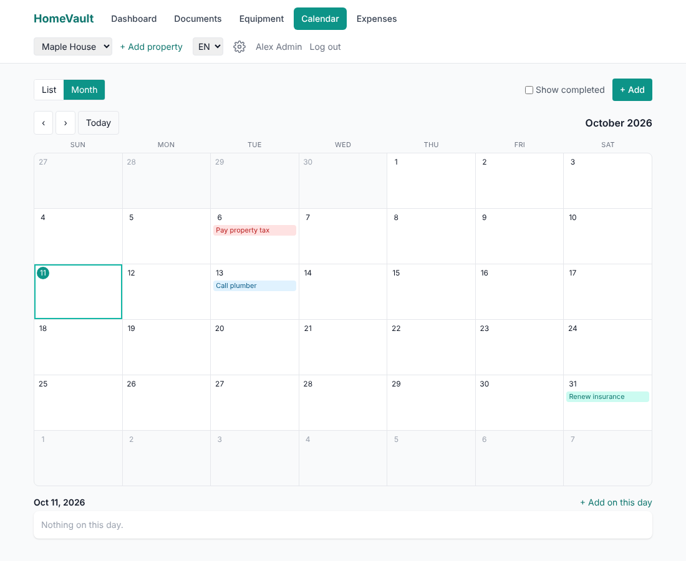 | 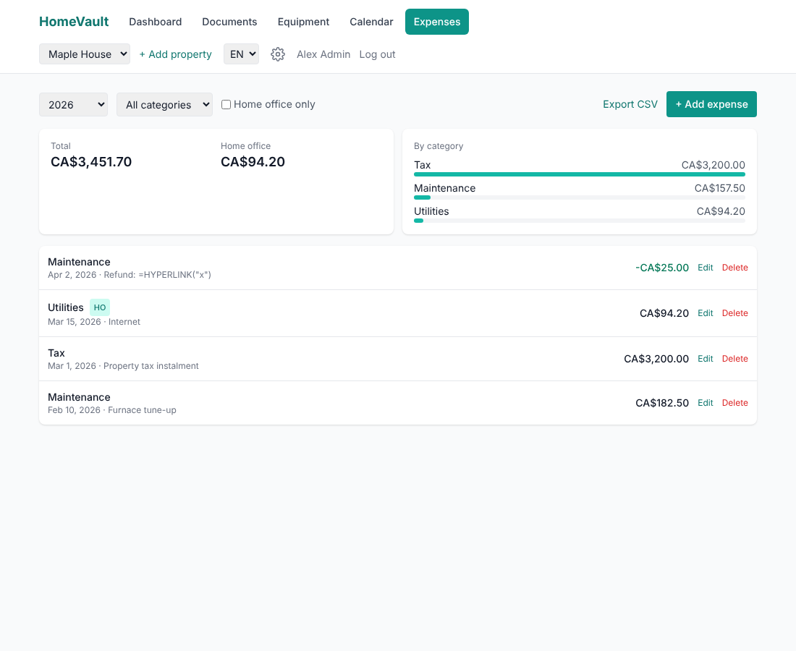 |

| QR code (printable label) | Settings (sharing & accounts) |
| --- | --- |
| 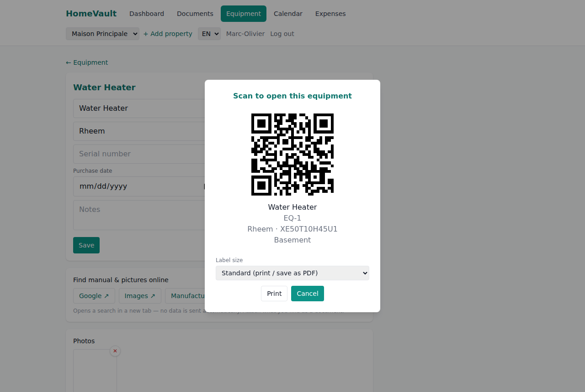 | 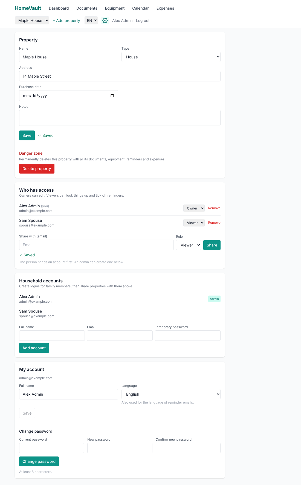 |

| Find anything (Ctrl/Cmd+K) | Security: 2FA, devices, activity |
| --- | --- |
| 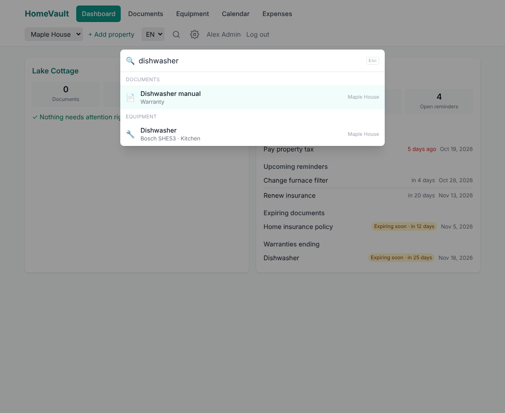 | 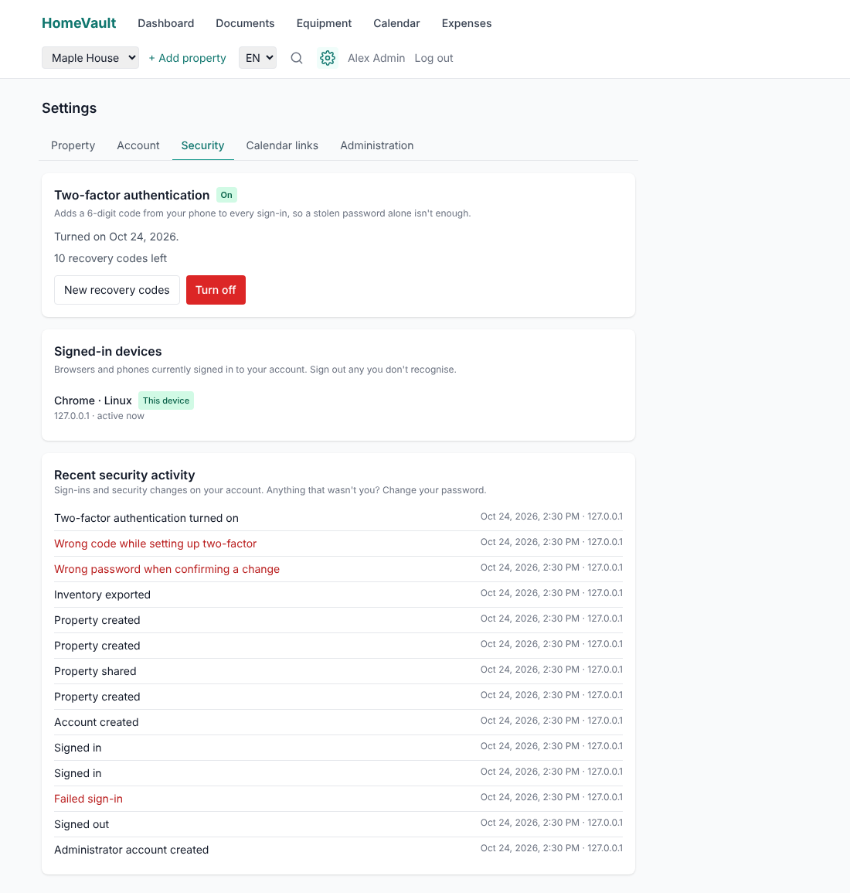 |

| Mobile (bottom nav) |
| --- |
| 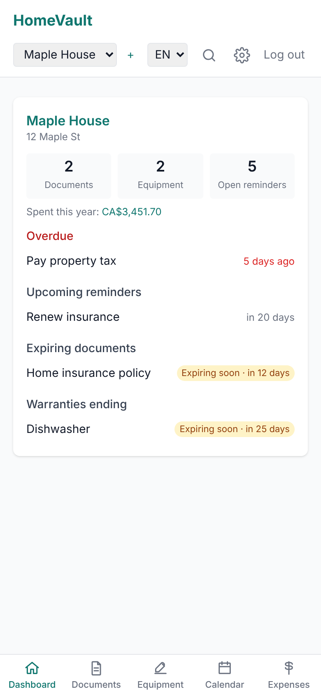 |

## Stack

- **Backend**: Node.js + Express, REST API, SQLite via `better-sqlite3` (zero
  external DB service to run). Postgres is not wired up yet — SQLite keeps a
  single-container NAS deploy trivial and is plenty for a household's data
  volume; if you outgrow it, the `db/` layer is the place to swap it in.
- **Frontend**: React + Vite, Tailwind CSS, mobile-first, installable as a
  PWA (`vite-plugin-pwa`) on iOS and Android.
- **QR codes**: generated entirely client-side (`qrcode.react`) — no
  third-party API call, consistent with "no telemetry, data stays local."
- **Auth**: local email/password (scrypt), server-side sessions in an
  `HttpOnly` `SameSite=Strict` cookie that can be revoked per device, optional
  TOTP two-factor authentication with recovery codes, multi-user households via
  per-property `owner`/`viewer` roles (see [Roles](#roles)). Roles are
  re-checked against the database on every request, so removing someone takes
  effect immediately. An audit log records sign-ins and security changes.
  Details and limits: [docs/SECURITY.md](docs/SECURITY.md).
- **File storage**: local volume (`UPLOAD_DIR`), path configurable to a NAS
  mount.
- **i18n**: `react-i18next` with English and French UI strings from day one.

## Folder structure

```
HomeVault/
├── backend/
│   ├── src/
│   │   ├── db/            # schema.sql, indexes.sql, sqlite connection/backup/maintenance
│   │   ├── middleware/     # sessions, CSRF guard, per-property access control
│   │   ├── routes/         # auth (+2FA, users, sessions), admin, properties,
│   │   │                   #   documents, equipment, reminders, tasks, expenses,
│   │   │                   #   calendar + ICS feeds, search, export, dashboard
│   │   ├── utils/           # crypto (scrypt, AES-GCM), TOTP, sessions, audit log,
│   │   │                   #   throttling, recurrence math, mailer, reminder engine,
│   │   │                   #   safe upload handling
│   │   ├── app.js           # createApp(): express app (used by tests too)
│   │   ├── cli.js           # admin CLI: create-admin, reset-password, backup, ...
│   │   ├── config.js        # startup configuration checks
│   │   └── server.js        # entrypoint: cron jobs, listen, graceful shutdown
│   └── test/                 # node:test suite (npm test)
├── frontend/
│   └── src/
│       ├── api/              # fetch client
│       ├── auth/             # AuthContext (login/setup/logout)
│       ├── property/         # PropertyContext (multi-property switcher)
│       ├── components/       # Layout (top nav + mobile tab bar),
│       │                     #   PropertySwitcher, InstallPrompt, QrModal,
│       │                     #   Modal, ConfirmDialog, ExpiryBadge, ...
│       ├── hooks/            # useAsync (loading/error state), useDebounced
│       ├── pages/            # Login, ForcePasswordChange, Dashboard, Documents,
│       │                     #   DocumentDetail, Equipment, EquipmentDetail,
│       │                     #   Calendar, Expenses, Settings (lazy-loaded routes)
│       ├── utils/            # date, recurrence and money formatting
│       └── i18n/              # en.json / fr.json (checked by npm run check:i18n)
├── docs/                       # SECURITY.md, DEPLOYMENT.md, screenshots/
├── install.sh                  # curl | bash bootstrap: downloads a release, starts the wizard
├── deploy.sh                   # install / wizard / update / backup / restore / doctor ...
├── deploy/Caddyfile            # automatic-HTTPS reverse proxy (--domain)
├── updater/                    # the helper behind the Update button (docker CLI + updater.sh)
├── scripts/                    # wizard.sh, smoke-test.sh and the end-to-end tests CI runs
├── CHANGELOG.md                # what changed in each release
├── docker/entrypoint.sh        # fixes data-volume ownership, drops root
├── Dockerfile                 # multi-stage: builds frontend, runs backend
└── docker-compose.yml          # hardened service definition + optional HTTPS profile
```

The backend serves the built frontend as static files in production, so the
whole app ships as **one container** — no reverse-proxy path juggling beyond
what you already do for other services.

## Data model

| Table              | Purpose                                                                 |
| ------------------- | ------------------------------------------------------------------------ |
| `users`             | login (scrypt hash) + `is_admin` flag + preferred `locale`; 2FA secret (encrypted), disabled / must-change-password flags |
| `sessions`          | one row per signed-in browser: hashed token, device, IP, last seen, expiry, revoked |
| `recovery_codes`    | single-use 2FA recovery codes (stored hashed)                           |
| `audit_log`         | who did what, when and from where (sign-ins, failures, security changes) |
| `calendar_feeds`    | secret calendar-subscription links (stored hashed, individually revocable) |
| `properties`        | name, address, type, purchase_date, notes                              |
| `property_access`   | many-to-many users↔properties with `role` (`owner`/`viewer`)            |
| `documents`         | file + category (invoice/warranty/insurance/contract/photo/maintenance/tax/other), dates, tags, optional link to an `equipment` item |
| `equipment`         | physical appliances/tools: brand, model number, serial number, category, location, purchase/warranty dates, purchase price + currency, notes |
| `equipment_photos`  | photo gallery per equipment item (file upload or camera capture)        |
| `maintenance_logs`  | per-equipment history: date, description, cost, who did it, optional receipt document |
| `reminders`         | due date, `recurrence` (none/monthly/yearly/custom), lead time, optional link to a document or equipment item; remembers which due date it last emailed about |
| `tasks`             | calendar events per property, optionally linked to a document, with recurrence |
| `expenses`          | amount, category, `is_home_office` flag, optional receipt document link |

Full column definitions are in `backend/src/db/schema.sql`. The schema is
applied automatically on backend startup (`CREATE TABLE IF NOT EXISTS`, plus
a small `ensureColumn` migration in `db/index.js` for columns added after a
database already existed), so there's no separate migration step to run.

## Key features implemented

1. Property CRUD (edit/delete in **Settings**) and a dashboard per property
   showing overdue items, upcoming reminders, expiring documents, ending
   equipment warranties, item counts and year-to-date spend
2. Document upload per property with category, tags, expiry date, optional
   link to an equipment item, search (debounced, wildcard-safe), category and
   "expiring soon" filters, an edit screen, and a shareable detail page at
   `/documents/:id`
3. **Equipment / inventory tracking**: brand, model, serial number, location,
   warranty badge, a photo gallery (images only), linked documents, and a
   maintenance log (date, description, cost, who did it) per item. "Find
   manual & pictures online" shows ready-to-click Google/Images/manufacturer
   search links for the entered brand + model — no automatic external calls,
   you pick the right result yourself.
4. **QR codes** for documents and equipment: scan to open the item directly,
   or print one sized for a thermal/label printer (25×25mm, 51×25mm "2×1in",
   102×152mm "4×6in", or a custom size) with the item's ID, name, and key
   details on the label. A QR on the login page also lets you scan to open
   the app on your phone and install it.
5. **Calendar** with a list view (overdue / next 30 days / later / completed)
   and a month grid that projects recurring items into future months. Create,
   edit, complete, reopen and delete reminders and tasks; monthly, yearly or
   custom-interval repeats; completing an overdue recurring item jumps to the
   next *future* date, and month-end dates are clamped (Jan 31 → Feb 28).
6. **Email notices** (optional SMTP, cron-scheduled via `REMINDER_CHECK_CRON`):
   one digest per person and property covering reminders inside their lead
   window or overdue, documents about to expire and equipment warranties about
   to end. Each item is announced **once per due/expiry date**, in the
   recipient's language (EN/FR), and is retried if the mail server is down.
7. Home-office expense tracking: edit, filter by year/category/home-office,
   per-currency totals with a category breakdown, optional receipt link, and
   a CSV export (UTF-8 for Excel, protected against spreadsheet formula
   injection) at `/expenses/property/:id/export.csv`
8. Multi-property support with a property switcher in the header
9. **Sharing**: owners invite family members to a property as owner or viewer
   and revoke access; admins create household logins; everyone can change
   their own password and language (Settings)
10. "Export everything" — zip bundle of all documents plus a summary text file
    (property, documents, equipment, maintenance history, reminders, tasks,
    expenses) per property (`/export/property/:id/bundle.zip`), useful for an
    estate-transfer style archive
11. **Mobile / PWA**: installable on iOS and Android (proper meta tags,
    maskable icons, safe-area padding for notches), a bottom tab bar on
    phone-width screens, an install banner, and camera capture for document
    and equipment photos
12. **Find anything**: Ctrl/Cmd+K (or the magnifier in the header) searches
    documents, equipment, reminders, tasks and expenses across every property
    you can see; arrow keys and Enter jump straight to the match
13. **Home inventory**: purchase price and currency per item, a total value on
    the equipment page, and an inventory CSV for an insurance claim
    (spreadsheet-formula safe)
14. **One-click maintenance schedules**: suggested tasks per equipment category
    (replace the furnace filter, flush the water heater, test smoke alarms...)
    become a recurring reminder linked to the item
15. **Calendar subscriptions**: a private `.ics` link per person/device for
    Apple Calendar, Google Calendar or Outlook, with recurrence and alarms.
    The link's secret is shown once, stored hashed and revocable at any time
16. **Security**: two-factor authentication (authenticator app + recovery
    codes), a list of signed-in devices you can sign out remotely, a personal
    "recent security activity" feed, an admin audit log, admin-created
    accounts with a forced password change, and a password policy that
    rejects common and personal passwords
17. **Operations**: a setup wizard, `./deploy.sh` for install, update (with
    automatic backup and rollback), verified backup/restore and diagnostics;
    hardened container; nightly SQLite maintenance and snapshots; runs on
    amd64 and arm64 (Raspberry Pi)
18. **In-app updates**: administrators are told when a new release exists and
    can install it from Settings (password confirmation required); the app
    checks GitHub for releases and can be told not to (`UPDATE_CHECK=false`)

### Roles

| | Admin | Owner (of a property) | Viewer |
| --- | :-: | :-: | :-: |
| See the property and everything in it | all properties | ✓ | ✓ |
| Tick off / reopen reminders and tasks, log maintenance | ✓ | ✓ | ✓ |
| Add / edit / delete documents, equipment, reminders, tasks, expenses | ✓ | ✓ | – |
| Edit or delete the property, share it, revoke access | ✓ | ✓ | – |
| Create household accounts | ✓ | – | – |

A property always keeps at least one owner.

Not yet built: push notifications (email is wired up; browser push is a
natural follow-up now that the PWA service worker is in place), a Postgres
backend, raw ESC/POS or ZPL thermal printing (label printing instead relies
on your label printer's normal OS driver, which covers common ones like
Dymo/Brother QL/Rollo).

## Running locally (development)

```bash
# Backend
cd backend
cp .env.example .env   # set APP_SECRET and DATA_KEY (openssl rand -hex 32)
npm install
npm run dev             # http://localhost:4000

# Frontend (separate terminal)
cd frontend
npm install
npm run dev             # http://localhost:5173, proxies /api to :4000
```

On first visit, use "Create your HomeVault admin account" on the login page
(`POST /api/auth/setup`) — it's only allowed while the `users` table is
empty, so it can't be used to re-seed a running instance, and if `SETUP_TOKEN`
is set the token has to be entered too. Passwords must be at least 10
characters and not a common or personal one. Locked out? The admin CLI
(`node src/cli.js help`, or `./deploy.sh admin help` in Docker) can create an
administrator, reset a password or switch off a lost 2FA device.

The API authenticates with the session cookie, not an `Authorization` header.
From a script, sign in with `curl -c jar -X POST .../api/auth/login ...` and
send `-b jar` afterwards.

### Tests and checks

```bash
cd backend  && npm test            # node:test suite against the real app + a temp SQLite DB
cd frontend && npm run check:i18n  # EN/FR files in sync, no missing translation keys
cd frontend && npm run build
```

CI (`.github/workflows/ci.yml`) runs all of these, `npm audit`, shellcheck, and
a real `./deploy.sh install → smoke test → backup → restore → update` cycle on
every pull request. You can run `scripts/smoke-test.sh <url>` against any fresh
instance yourself.

## Running in Docker (NAS / homelab)

`./deploy.sh install` or the one-line installer (see [Quick start](#quick-start))
is the supported way. Under the hood it writes `.env`, then runs
`docker compose`; you can do that yourself too:

```bash
cp .env.example .env    # set APP_SECRET, DATA_KEY (openssl rand -hex 32) and SETUP_TOKEN
docker compose up -d --build
```

`APP_SECRET` is **required**: in production the app refuses to start if it is
missing, still the placeholder from `.env.example`, or shorter than 16
characters. `DATA_KEY` encrypts the two-factor secrets in the database, so keep
a copy of `.env` somewhere other than your backups.

The container listens on `4000` internally, published on `HOST_PORT`
(default `8080`). Point `DATA_DIR` at your NAS volume for the SQLite database,
uploaded files and scheduled backups. The service runs with a read-only root
filesystem, no capabilities beyond what the entrypoint needs to fix volume
ownership, `no-new-privileges`, memory/PID limits and log rotation, and the app
itself runs as the unprivileged `node` user. If your NAS mount refuses `chown`,
it logs a warning and keeps running as root.

Behind your own Traefik/Nginx instead of the bundled Caddy: proxy to the
published port, set `TRUST_PROXY=1`, and once HTTPS works set
`FORCE_HTTPS=true` (HSTS and `__Host-` cookies). Full details, backup/restore,
upgrades and troubleshooting: **[docs/DEPLOYMENT.md](docs/DEPLOYMENT.md)**.

### Updating

- **In the app:** *Settings → Administration → Software update*. Needs the updater helper, which
  the wizard offers to install (`./deploy.sh updater enable` adds it later).
- **From a terminal:** `./deploy.sh update` (newest release), `./deploy.sh update --check`,
  or `./deploy.sh update --to 1.2.0`.

Either way it takes a backup first, installs the release, checks that the new version is healthy
and otherwise puts the old one back.

### Upgrading from an earlier version

Run `./deploy.sh update` (it backs up first). Things that changed in 1.0:

- **Sign-in is now cookie-based.** Everyone is signed out once; scripts that
  sent `Authorization: Bearer ...` or `?token=` must sign in with a cookie jar.
- **`JWT_SECRET` is now `APP_SECRET`.** The old name still works. Also set
  `DATA_KEY` (and optionally `SETUP_TOKEN`); `deploy.sh` generates missing ones.
- Passwords are re-hashed with scrypt automatically the next time each person
  signs in. New passwords need 10+ characters and may not be common or contain
  your name or email.
- Reminders already inside their lead window trigger **one** email after the
  upgrade; from then on each due date is announced once.
- The first start adds new tables and indexes; there is nothing to migrate by hand.

### Backups

Two layers:

- **Nightly snapshot** (`BACKUP_CRON`, default 3am, newest `BACKUP_KEEP` kept) of
  the SQLite database into `BACKUP_DIR`, integrity-checked.
- **`./deploy.sh backup`** writes a single `backups/homevault-backup-*.tar.gz`
  with a consistent database snapshot **and** the uploaded files, safe while the
  app is running. `./deploy.sh restore <file>` puts it back (taking a safety
  backup first). Copy the archives off the machine, and keep `.env` with them.

## Roadmap / next phases

- Push notifications via the PWA service worker, as an alternative to SMTP
- Optional Postgres backend behind the same `db/` interface
- Passkeys / WebAuthn as a phishing-proof second factor
- Optional encryption of uploaded files at rest
- Pagination for very large document libraries
- Tailwind 4 migration (clears the remaining build-time-only `npm audit` notes)
- Estate-transfer bundle: add a generated summary PDF alongside the current
  `summary.txt` in the export zip
- Barcode *scanning* (as opposed to the QR codes HomeVault already
  generates) to look up a product by its manufacturer barcode
